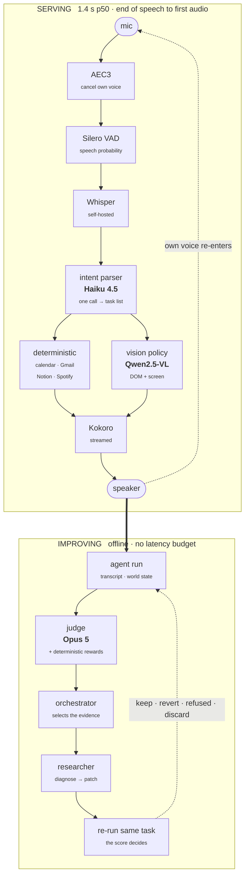

Imagine controlling your entire Mac with your voice — opening websites, navigating apps, answering
questions, and interacting with anything on your screen, all without touching your keyboard or
mouse.

This is the promise of voice-first AI agents: combining speech recognition, LLMs, vision models, and
low-latency inference into a system that can understand what you say and actually take action on
your computer.

In this write-up, I'll walk through how I built a self-hosted voice agent for macOS — from
real-time speech detection and GPU-accelerated speech-to-text to intelligent command routing,
vision-based UI interaction, and inference optimization. I'll cover the architecture behind the
system, the decisions that shaped each component, and the approaches I used to reduce latency and
make the agent feel fast and natural in real-time interactions.

  Demo
  Speech in, real work out — including an interruption handled mid-sentence
  
Screen recording of the end-to-end flow.

  <a class="demo-link" href="https://drive.google.com/file/d/1VYD-pNZ1JQjTf9YcGA3C4L3KdG8Uwdwj/view?usp=sharing" target="_blank" rel="noopener">Watch the demo</a>

## System architecture

The system has two parts: a **serving path**, where every step needs to meet a strict latency
target, and an **offline improvement loop**, where latency is not a constraint. The improvement loop
works because the serving path captures useful information at each stage — a transcript of what was
said, the tasks the agent identified, and the outcome of each action. These records give us
something concrete to evaluate, allowing a judge to assess the agent's performance and a reward
function to measure how well it did.

| Component | Choice | Why |
|---|---|---|
| Speech recognition | Whisper large-v3 | open weights, so it runs on owned hardware and can transcribe inside the endpoint wait rather than after it |
| Speech synthesis | Kokoro | streams in chunks, so playback starts before synthesis finishes |
| UI understanding | Qwen2.5-VL-32B (AWQ) | usable coordinate grounding, and AWQ fits one 80 GB card with room left to serve |
| Intent parsing | Claude Haiku 4.5 | structured output pinned by `tool_choice`, and reliable about returning `null` rather than inventing a value |
| Judge | Opus 5 | a tier above the model it grades, so it is not scoring its own house style |
| Echo cancellation | WebRTC AEC3 | the only one of three tested that left no speech-shaped residue |
| Voice activity | Silero VAD | returns a speech probability per frame rather than a raw energy threshold |

## Design choices

### Where intent parsing should run

**Correctness drove our choice of model for intent parsing.** We first tested a smaller local 32B
model, but it struggled to reliably follow the structured output requirements. If the user didn't
provide a `depart_date`, for example, the model might default to today's date. It could also assume
a `trip_type` such as one-way when the user hadn't specified one. **Claude Haiku 4.5**, on the other
hand, consistently followed the schema and returned `null` when a value was not provided.

We initially expected the local model to have a significant latency advantage because the GPU was
already serving our vision model. But in side-by-side testing, the local model took **1.5–2 seconds
per call**, giving us only about a **100–400 ms** advantage over the hosted model.

At that point, the trade-off was straightforward: **a few hundred milliseconds of latency wasn't
worth sacrificing correctness.** We use Claude for intent parsing, where accurate interpretation is
critical, while keeping the vision model local.

### How to represent an utterance

The next question was how to represent a user's request. A simple approach is to classify each
transcript into one intent. Natural speech quickly breaks this assumption:

> "Find me a flight to Denver on the 23rd — no wait, the 30th, and put on some music."

This contains a **self-correction** and a **second request**. A single-intent classifier has to
choose one interpretation and will lose something.

Instead, we represent each utterance as a **list of tasks**. Each task contains its intent,
parameters, execution details, and dependencies.

<figure class="diagram">
<svg viewBox="0 0 720 214" role="img" aria-labelledby="parse-t">
  <title id="parse-t">One utterance under a single-intent classifier and under a task list</title>
  <g font-family="Inter, system-ui, sans-serif" fill="currentColor">

    <rect x="60" y="8" width="600" height="32" rx="7" fill="var(--d-fill)" stroke="var(--d-line)"/>
    <text x="360" y="28" font-size="11" font-style="italic" text-anchor="middle">"a flight to Denver on the 23rd — no wait, the 30th, and put on some music"</text>

    <path d="M300 40 L300 54 L180 54 L180 68" fill="none" stroke="var(--d-line)"/>
    <path d="M420 40 L420 54 L540 54 L540 68" fill="none" stroke="var(--d-line)"/>
    <polygon points="180,74 176,64 184,64" fill="var(--d-line)"/>
    <polygon points="540,74 536,64 544,64" fill="var(--d-line)"/>

    <text x="180" y="90" font-size="9.5" font-weight="700" text-anchor="middle" letter-spacing="0.06em" fill="var(--d-muted)">SINGLE INTENT</text>
    <rect x="60" y="100" width="240" height="38" rx="7" fill="var(--d-fill)" stroke="var(--d-warn)"/>
    <text x="180" y="124" font-size="11" text-anchor="middle" font-family="JetBrains Mono, monospace">flight_search</text>
    <text x="180" y="158" font-size="9.5" text-anchor="middle" fill="var(--d-warn)">the correction to the 30th is lost</text>
    <text x="180" y="174" font-size="9.5" text-anchor="middle" fill="var(--d-warn)">the music request is dropped</text>

    <text x="540" y="90" font-size="9.5" font-weight="700" text-anchor="middle" letter-spacing="0.06em" fill="var(--d-muted)">TASK LIST</text>
    <rect x="420" y="100" width="240" height="38" rx="7" fill="var(--d-accent-soft)" stroke="var(--d-accent)"/>
    <text x="540" y="117" font-size="10" text-anchor="middle" font-family="JetBrains Mono, monospace">google_flights_search</text>
    <text x="540" y="131" font-size="9.5" text-anchor="middle" fill="var(--d-good)">depart_date: 2026-08-30</text>
    <rect x="420" y="146" width="240" height="30" rx="7" fill="var(--d-accent-soft)" stroke="var(--d-accent)"/>
    <text x="540" y="166" font-size="10" text-anchor="middle" font-family="JetBrains Mono, monospace">spotify_play</text>

    <text x="540" y="198" font-size="9.5" text-anchor="middle" fill="var(--d-muted)">correction resolved inside the parse</text>
  </g>
</svg>
</figure>

This keeps corrections and compound requests inside the parsing layer. They don't need special
handling later.

The same idea applies to routing. Adding more keywords doesn't solve routing failures. **Context
does.** The router uses the last eight turns from both sides, along with preferences accumulated
across sessions.

### Slot filling without guessing

The rule is simple: **if the user didn't provide a value, return `null`. Never guess.**

For example:

> "Book me a flight to Denver."

The agent should ask for the date instead of assuming tomorrow.

<figure class="diagram">
<svg viewBox="0 0 700 182" role="img" aria-labelledby="guess-t">
  <title id="guess-t">Guessing a missing field versus returning null</title>
  <g font-family="Inter, system-ui, sans-serif" fill="currentColor">
    <text x="170" y="14" font-size="9.5" font-weight="700" text-anchor="middle" letter-spacing="0.06em" fill="var(--d-warn)">GUESSING</text>
    <text x="530" y="14" font-size="9.5" font-weight="700" text-anchor="middle" letter-spacing="0.06em" fill="var(--d-good)">REFUSING TO GUESS</text>

    <rect x="40" y="26" width="260" height="34" rx="7" fill="var(--d-fill)" stroke="var(--d-warn)"/>
    <text x="170" y="47" font-size="10.5" text-anchor="middle" font-family="JetBrains Mono, monospace">depart_date: "tomorrow"</text>
    <rect x="400" y="26" width="260" height="34" rx="7" fill="var(--d-fill)" stroke="var(--d-good)"/>
    <text x="530" y="47" font-size="10.5" text-anchor="middle" font-family="JetBrains Mono, monospace">depart_date: null</text>

    <line x1="170" y1="60" x2="170" y2="76" stroke="var(--d-line)"/><polygon points="170,82 166,72 174,72" fill="var(--d-line)"/>
    <line x1="530" y1="60" x2="530" y2="76" stroke="var(--d-line)"/><polygon points="530,82 526,72 534,72" fill="var(--d-line)"/>

    <text x="170" y="100" font-size="10.5" text-anchor="middle">searches a date the user never gave</text>
    <text x="530" y="100" font-size="10.5" text-anchor="middle">asks for the missing date</text>

    <line x1="170" y1="110" x2="170" y2="126" stroke="var(--d-line)"/><polygon points="170,132 166,122 174,122" fill="var(--d-line)"/>
    <line x1="530" y1="110" x2="530" y2="126" stroke="var(--d-line)"/><polygon points="530,132 526,122 534,122" fill="var(--d-line)"/>

    <rect x="40" y="140" width="260" height="32" rx="7" fill="var(--d-fill)" stroke="var(--d-warn)"/>
    <text x="170" y="160" font-size="10.5" text-anchor="middle" fill="var(--d-warn)">plausible, and wrong</text>
    <rect x="400" y="140" width="260" height="32" rx="7" fill="var(--d-fill)" stroke="var(--d-good)"/>
    <text x="530" y="160" font-size="10.5" text-anchor="middle" fill="var(--d-good)">correct search</text>
  </g>
</svg>
</figure>

Asking costs one extra turn. Guessing can produce a result the user never asked for. A wrong date
can still look completely valid.

We apply the same rule beyond parsing. If a calendar lookup fails, the agent reports the failure
instead of returning an empty schedule. **When the system doesn't know, it should say so.**

### Choosing the text-to-speech engine

For TTS, we had two requirements: natural enough for conversation and fast enough for streaming.

We first tested **Piper**, which runs fully on-device and is extremely lightweight. Tuning its
prosody did not improve the voice enough. This suggested the limitation was the model rather than
its configuration.

We then tested **Kokoro** on GPU with vLLM capped at 60% utilization:

| Model | First call | Warm |
|---|---:|---:|
| Kokoro (GPU) | ~1370 ms | **84–128 ms** |
| Piper (on-device) | — | 139–506 ms |

**Kokoro turned out to be fast enough for real-time streaming once it had GPU access.**

The broader lesson was that benchmarks depend on the system configuration. When resource allocation
changes, previously rejected components should be tested again.

### Choosing between DOM and vision

For browser interaction, we use **DOM for deterministic tasks and vision for tasks that require
visual understanding**.

The DOM gives us a structured view of the page: elements, labels, roles, and positions. This works
well when we already know exactly what action to take. For example, **opening Google, searching
YouTube, or clicking a known button** are deterministic actions. The agent already knows what to do,
so there is no reason to spend a vision-model call on them.

Vision is used when the agent needs to **look at the screen and make a decision**. Shopping is a
good example. The agent may need to identify the right product from several results, check its
appearance, or choose the correct size. These decisions require visual understanding.

<figure class="diagram">
<svg viewBox="0 0 700 162" role="img" aria-labelledby="dom-t">
  <title id="dom-t">Deterministic actions routed to the DOM, decisions routed to vision</title>
  <g font-family="Inter, system-ui, sans-serif" fill="currentColor">
    <text x="170" y="14" font-size="9.5" font-weight="700" text-anchor="middle" letter-spacing="0.06em" fill="var(--d-muted)">DETERMINISTIC</text>
    <text x="530" y="14" font-size="9.5" font-weight="700" text-anchor="middle" letter-spacing="0.06em" fill="var(--d-muted)">NEEDS A DECISION</text>

    <g font-size="10.5" text-anchor="middle">
      <text x="170" y="38">Open Google</text>
      <text x="170" y="56">Search YouTube</text>
      <text x="170" y="74">Click a known element</text>
      <text x="530" y="38">Find the right product</text>
      <text x="530" y="56">Choose the correct size</text>
      <text x="530" y="74">Identify an item on screen</text>
    </g>

    <line x1="170" y1="86" x2="170" y2="100" stroke="var(--d-line)"/><polygon points="170,106 166,96 174,96" fill="var(--d-line)"/>
    <line x1="530" y1="86" x2="530" y2="100" stroke="var(--d-line)"/><polygon points="530,106 526,96 534,96" fill="var(--d-line)"/>

    <rect x="90" y="114" width="160" height="38" rx="8" fill="var(--d-fill)" stroke="var(--d-line)"/>
    <text x="170" y="132" font-size="11" font-weight="600" text-anchor="middle">DOM</text>
    <text x="170" y="145" font-size="8.5" text-anchor="middle" fill="var(--d-muted)">exact, milliseconds</text>

    <rect x="450" y="114" width="160" height="38" rx="8" fill="var(--d-accent-soft)" stroke="var(--d-accent)"/>
    <text x="530" y="132" font-size="11" font-weight="600" text-anchor="middle">Vision</text>
    <text x="530" y="145" font-size="8.5" text-anchor="middle" fill="var(--d-muted)">screenshot → inference</text>
  </g>
</svg>
</figure>

This separation also keeps the system fast. **DOM handles what we already know how to do; vision is
reserved for decisions that require visual reasoning.**

### Handling interruptions

While the agent speaks, the microphone captures both the **agent's voice and the user's voice**. A
simple speech detector therefore sees the agent's own output as a potential interruption. Before
echo cancellation, the agent could even interrupt itself during its startup line.

A single volume threshold cannot solve this because the loudest signal may be the agent itself. We
handle interruption detection as a sequence of checks:

<figure class="diagram">
<svg viewBox="0 0 700 126" role="img" aria-labelledby="pipe-t">
  <title id="pipe-t">The staged interruption pipeline</title>
  <g font-family="Inter, system-ui, sans-serif" fill="currentColor">
    <g font-size="9.5" text-anchor="middle">
      <rect x="6" y="26" width="104" height="30" rx="6" fill="var(--d-fill)" stroke="var(--d-line)"/><text x="58" y="45">AEC3</text>
      <rect x="124" y="26" width="86" height="30" rx="6" fill="var(--d-fill)" stroke="var(--d-line)"/><text x="167" y="45">VAD</text>
      <rect x="224" y="26" width="118" height="30" rx="6" fill="var(--d-fill)" stroke="var(--d-line)"/><text x="283" y="45">rolling window</text>
      <rect x="356" y="26" width="106" height="30" rx="6" fill="var(--d-fill)" stroke="var(--d-line)"/><text x="409" y="45">energy floor</text>
      <rect x="476" y="26" width="118" height="30" rx="6" fill="var(--d-fill)" stroke="var(--d-line)"/><text x="535" y="45">double-talk</text>
      <rect x="608" y="26" width="86" height="30" rx="6" fill="var(--d-fill)" stroke="var(--d-line)"/><text x="651" y="45">pause</text>

      <rect x="224" y="86" width="118" height="30" rx="6" fill="var(--d-fill)" stroke="var(--d-line)"/><text x="283" y="105">transcript check</text>
      <rect x="356" y="86" width="176" height="30" rx="6" fill="var(--d-accent-soft)" stroke="var(--d-accent)"/><text x="444" y="105">classify and commit</text>
    </g>

    <g stroke="var(--d-line)">
      <line x1="110" y1="41" x2="118" y2="41"/><polygon points="124,41 114,37 114,45" fill="var(--d-line)"/>
      <line x1="210" y1="41" x2="218" y2="41"/><polygon points="224,41 214,37 214,45" fill="var(--d-line)"/>
      <line x1="342" y1="41" x2="350" y2="41"/><polygon points="356,41 346,37 346,45" fill="var(--d-line)"/>
      <line x1="462" y1="41" x2="470" y2="41"/><polygon points="476,41 466,37 466,45" fill="var(--d-line)"/>
      <line x1="594" y1="41" x2="602" y2="41"/><polygon points="608,41 598,37 598,45" fill="var(--d-line)"/>
      <path d="M651 56 L651 70 L283 70 L283 80" fill="none"/><polygon points="283,86 279,76 287,76" fill="var(--d-line)"/>
      <line x1="342" y1="101" x2="350" y2="101"/><polygon points="356,101 346,97 346,105" fill="var(--d-line)"/>
    </g>

    <text x="6" y="16" font-size="9" fill="var(--d-muted)">acoustic — any stage can rule the interruption out</text>
    <text x="224" y="78" font-size="9" fill="var(--d-muted)">needs the transcript</text>
  </g>
</svg>
</figure>

Echo cancellation is the first and most important step. We tested three cancellers using 50 frames
containing only the agent's speech played back into the microphone:

| Canceller | False speech frames |
|---|---:|
| NLMS (hand-built) | 21 / 50 |
| SpeexDSP | 18–19 / 50 |
| **WebRTC AEC3** | **0 / 50** |

The other filters removed a lot of energy, but the remaining signal still sounded like speech. That
was enough for the neural VAD to trigger. The important metric is therefore not simply **how much
audio was cancelled**, but **whether the remaining audio still looks like speech**.

The pause is also reversible because acoustics alone aren't enough. We compare the transcript
against what the agent was saying at the time. If it matches the agent's own speech, we resume
playback instead of committing the interruption.

### Gating irreversible actions

The final design choice is around actions that are difficult to undo.

Anything that **spends money, sends a message, or overwrites data** requires explicit confirmation.
The confirmation also fails closed: if there is ambiguity, the action is cancelled.

Before a purchase, the agent reads back the **item, variant, quantity, total, address, and payment
method**, then waits for a clear spoken confirmation.

We reject responses like "mhm" or "okay" because they can simply mean the user is listening. We also
reject anything spoken while the agent is reading the summary, since the user may not have heard the
full details.

For irreversible actions, a little extra latency is worth it. **The system should be fast when it
can be, and conservative when mistakes are expensive.**

With those decisions in place, the remaining questions are how fast the system feels, how we measure
whether it actually works, and how those measurements feed the loop that improves it.

## Reducing perceived latency

Voice has no loading indicator, so **silence feels like latency**. Our pipeline reaches about
**1.4 s p50** from end-of-speech to first audio by overlapping work wherever possible.

We start transcription **before the turn ends**, using the endpointing window to run recognition in
parallel. For TTS, we stream the first audio chunk immediately. Moving synthesis to the GPU reduced
time-to-first-audio from **~870 ms to ~260 ms**. Interruptions are also cheap: stopping active and
queued audio takes about **20 ms**.

For unavoidable delays, we use short acknowledgements like **"Okay," "On it," or "Let me check."**
Longer operations get another update at **3.5 s and 11 s**, so a slow API call doesn't feel like
silence.

The main remaining bottleneck is **vision**. Lower screenshot resolution and JPEG quality reduce
inference time but also remove information the model may need, making this a good candidate for
automated optimization.

## Evaluation

We evaluate the agent on two things: **whether it completes the task correctly and whether our LLM
judge can reliably measure that correctness**.

The benchmark contains **288 logged turns** plus live task runs covering the same intent mix:
Spotify playlist creation, Gmail drafts, navigation, flight search, and constrained shopping on real
websites.

The live set mirrors observed traffic rather than probing for failures:

| | share of real traffic | in the live set |
|---|---:|---|
| Browser navigation | 42% | open a site, search a retailer, read back a result |
| Spotify playlists | 27% | create a playlist with a named artist or track count |
| Gmail | 7% | draft a reply, search the inbox (drafts only, never sent) |
| Vision | 7% | act on something only visible on screen |
| Flights | 6% | search against the live calendar |
| Q&A, smalltalk, explain | ~18% | the conversational tail |

Alongside that sits a browser task suite of roughly 100 tasks in difficulty tiers, from single known
controls up to constrained shopping — a specific product in a specific size and colour, driven
through to cart.

We verify results from the **actual environment**. For example, we check whether an item is really
in the cart or whether a Gmail draft actually exists through provider APIs.

We define **156 failure modes** across 10 categories: target, extent, context, consent, side
effects, timing, reporting, recovery, liveness, and fabrication.

The judge is **Opus 5**, while the agent's intent parsing uses Haiku. We deliberately use a
stronger, separate model to reduce judge bias. The judge scores each check independently and can
abstain when there isn't enough evidence. It never sees the expected answer, and turns without a
recorded world state are not scored.

Human labels are split **70/30** between development and held-out sets. The evaluation spec improved
agreement from 58% to 90% on the development set, but only 56% (κ = 0.33) on the sealed set of nine
scenarios. The gap showed that part of the improvement came from fitting the judge to its
development labels, so only the held-out score drives the improvement loop.

## The self-improving loop

Instead of manually reading traces, deciding what broke, patching it, and judging whether it
improved, the loop runs that process automatically:

<figure class="diagram">
<svg viewBox="0 0 700 122" role="img" aria-labelledby="loop-t">
  <title id="loop-t">The improvement loop, from a scored run back around to the next round</title>
  <g font-family="Inter, system-ui, sans-serif" fill="currentColor">

    <g font-size="10.5" text-anchor="middle">
      <rect x="0" y="18" width="128" height="46" rx="8" fill="var(--d-fill)" stroke="var(--d-line)"/>
      <text x="64" y="38" font-weight="600">agent run</text>
      <text x="64" y="52" font-size="8.5" fill="var(--d-muted)">+ world state</text>

      <rect x="142" y="18" width="128" height="46" rx="8" fill="var(--d-accent-soft)" stroke="var(--d-accent)"/>
      <text x="206" y="38" font-weight="600">judge</text>
      <text x="206" y="52" font-size="8.5" fill="var(--d-muted)">Opus 5 + rewards</text>

      <rect x="284" y="18" width="128" height="46" rx="8" fill="var(--d-fill)" stroke="var(--d-line)"/>
      <text x="348" y="38" font-weight="600">orchestrator</text>
      <text x="348" y="52" font-size="8.5" fill="var(--d-muted)">picks the evidence</text>

      <rect x="426" y="18" width="128" height="46" rx="8" fill="var(--d-accent-soft)" stroke="var(--d-accent)"/>
      <text x="490" y="38" font-weight="600">researcher</text>
      <text x="490" y="52" font-size="8.5" fill="var(--d-muted)">diagnose → patch</text>

      <rect x="568" y="18" width="132" height="46" rx="8" fill="var(--d-good-soft)" stroke="var(--d-good)"/>
      <text x="634" y="38" font-weight="600">re-run same task</text>
      <text x="634" y="52" font-size="8.5" fill="var(--d-muted)">the score decides</text>
    </g>

    <g stroke="var(--d-line)">
      <line x1="128" y1="41" x2="136" y2="41"/><polygon points="142,41 132,37 132,45" fill="var(--d-line)"/>
      <line x1="270" y1="41" x2="278" y2="41"/><polygon points="284,41 274,37 274,45" fill="var(--d-line)"/>
      <line x1="412" y1="41" x2="420" y2="41"/><polygon points="426,41 416,37 416,45" fill="var(--d-line)"/>
      <line x1="554" y1="41" x2="562" y2="41"/><polygon points="568,41 558,37 558,45" fill="var(--d-line)"/>
    </g>

    <path d="M634 64 L634 96 L64 96 L64 70" fill="none" stroke="var(--d-muted)" stroke-dasharray="3 3"/>
    <polygon points="64,64 60,74 68,74" fill="var(--d-muted)"/>
    <text x="349" y="92" font-size="9" text-anchor="middle" fill="var(--d-muted)">keep · revert · refused · discard — then the next round</text>
  </g>
</svg>
</figure>

Four roles stay separate: **Haiku 4.5 + Qwen2.5-VL** are the subject, **Opus 5** is the judge, the
**orchestrator** controls the evidence, and the **researcher** diagnoses and patches failures.

### Diagnose before patching

We found that asking the researcher directly for a fix produced several similar patches, all
predicting perfect scores. Asking it to **diagnose the failure first** led to a much more useful
result: three task failures were traced to a single `(0,0)` click leaking through a fail-safe.

Patches now require an explicit diagnosis and an observation that could disprove it.

### Four outcomes

<figure class="diagram">
<svg viewBox="0 0 700 166" role="img" aria-labelledby="out-t">
  <title id="out-t">The four round outcomes</title>
  <g font-family="Inter, system-ui, sans-serif" fill="currentColor">
    <g font-size="10.5">
      <rect x="0" y="6" width="700" height="34" rx="7" fill="var(--d-good-soft)" stroke="var(--d-good)"/>
      <text x="18" y="28" font-weight="700" fill="var(--d-good)" font-family="JetBrains Mono, monospace">KEEP</text>
      <text x="120" y="28">the re-run scored higher — the patch stays</text>

      <rect x="0" y="46" width="700" height="34" rx="7" fill="var(--d-fill)" stroke="var(--d-line)"/>
      <text x="18" y="68" font-weight="700" fill="var(--d-muted)" font-family="JetBrains Mono, monospace">REVERT</text>
      <text x="120" y="68">no improvement — the patch is rolled back</text>

      <rect x="0" y="86" width="700" height="34" rx="7" fill="var(--d-fill)" stroke="var(--d-line)"/>
      <text x="18" y="108" font-weight="700" fill="var(--d-muted)" font-family="JetBrains Mono, monospace">REFUSED</text>
      <text x="120" y="108">the patch could not be applied safely</text>

      <rect x="0" y="126" width="700" height="34" rx="7" fill="var(--d-fill)" stroke="var(--d-warn)"/>
      <text x="18" y="148" font-weight="700" fill="var(--d-warn)" font-family="JetBrains Mono, monospace">DISCARD</text>
      <text x="120" y="148">the run was unobservable — run it again, never score it zero</text>
    </g>
  </g>
</svg>
</figure>

The loop can change **prompts, policies, and training parameters**, but it cannot change the
**labels, scorer, or held-out split**.

### Cheap rewards

LLM judges are too slow and expensive to use as a per-step RL reward. For interruption recovery, we
instead use deterministic signals from what happens next:

<figure class="diagram">
<svg viewBox="0 0 700 194" role="img" aria-labelledby="rew-t">
  <title id="rew-t">Deterministic reward signals read from the following turns</title>
  <g font-family="Inter, system-ui, sans-serif" fill="currentColor">
    <text x="0" y="12" font-size="9.5" font-weight="700" letter-spacing="0.06em" fill="var(--d-muted)">AFTER A RECOVERY, THE USER…</text>
    <g font-size="10.5">
      <rect x="0" y="24" width="700" height="28" rx="6" fill="var(--d-fill)" stroke="var(--d-line)"/>
      <text x="16" y="42">repeats the request</text><text x="300" y="42" fill="var(--d-warn)">the recovery lost it</text>

      <rect x="0" y="58" width="700" height="28" rx="6" fill="var(--d-fill)" stroke="var(--d-line)"/>
      <text x="16" y="76">interrupts again</text><text x="300" y="76" fill="var(--d-warn)">it did not take</text>

      <rect x="0" y="92" width="700" height="28" rx="6" fill="var(--d-fill)" stroke="var(--d-line)"/>
      <text x="16" y="110">says stop, or no</text><text x="300" y="110" fill="var(--d-warn)">it went somewhere wrong</text>

      <rect x="0" y="126" width="700" height="28" rx="6" fill="var(--d-good-soft)" stroke="var(--d-good)"/>
      <text x="16" y="144">completes the task</text><text x="300" y="144" fill="var(--d-good)">it worked</text>

      <rect x="0" y="160" width="700" height="28" rx="6" fill="var(--d-good-soft)" stroke="var(--d-good)"/>
      <text x="16" y="178">moves on</text><text x="300" y="178" fill="var(--d-good)">nothing to fix</text>
    </g>
  </g>
</svg>
</figure>

Three of those five signals are negatives about being interrupted, which leaves an obvious exploit:
an agent that can never be interrupted scores perfectly on all three. **Task completion is therefore
a required positive term, not a bonus** — a policy that dodges every interruption and finishes
nothing still scores badly.

### What we have trained

One common vision failure is a **dead click**: the action changes nothing, and the model clicks the
same place again. These episodes naturally produce preference pairs: same screen, one ineffective
action versus the better alternative.

From **232 episodes**, we generated **133 preference pairs** from real screens and sites.

We train a **7B model** rather than the 32B serving model. DPO requires both the policy and
reference model in memory, which does not fit alongside the 32B model on one 80 GB GPU. The smaller
model also makes iteration much cheaper.

| Metric | Baseline | Trained |
|---|---:|---:|
| Held-out preference accuracy | 0.5455 | **0.7727** |
| Reward margin | −0.0006 | **+0.0257** |

## What's next

Most of the near-term work is focused on making the improvement loop fully autonomous:

- **Scale the loop across the validation set.** Run each prompt in its own loop and budget so one
  difficult task cannot consume the rounds meant for another. Each round records the diagnosis,
  confidence, patch status, and re-run result.
- **Close the training loop.** DPO on the vision model is still triggered manually. The goal is for
  the loop to propose the training change, run it, and keep or revert it based on the held-out
  score. The final step is serving the tuned adapter so improvements are measured on the live agent.
- **Learn interruption recovery.** What happens after an interruption — resume, recap, restart,
  drop, or amend — is still a hardcoded decision table. This is a good RL target because it runs
  once per turn, not per audio frame, and the following turns already provide the reward signal. The
  main blocker is collecting enough episodes.

## Limitations

- The DPO result is small. 22 held-out examples, so each moves the score about 4.5 points and the
  confidence interval is roughly ±0.18. Read `0.77` as "clearly moved", not "77% accurate".
- The acoustic evaluation uses synthetic audio. It pins the detection logic, not behaviour across
  real microphones, rooms and background noise. The sweep calls `min_raw_rms=0.003` optimal on a
  fixture set built around 0.003, which is circular.
- Self-correction works only within a single utterance, so a correction made across turns creates a
  duplicate rather than a fix. The vision path captures the primary display only, so a browser on an
  external monitor is operated on the wrong screen.
