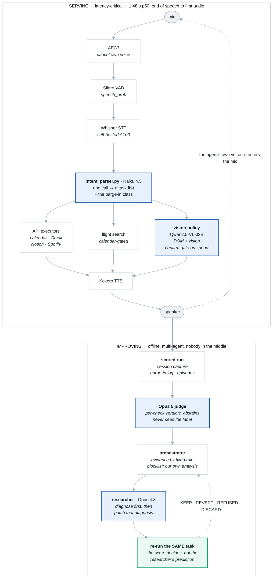

  Built &amp; running
  Whisper · Kokoro · Qwen2.5-VL-32B
  Claude Haiku 4.5 · Opus 5 judge
  WebRTC AEC3 · Silero VAD
  QLoRA · DPO

Building a voice agent that can execute a command is easy.

Building one that can **reliably operate a desktop, handle interruptions, recover from mistakes,
interact with UIs it has never seen, and improve from its own failures** is a very different
problem.

This project is an end-to-end voice agent running on macOS that combines speech recognition, task
planning, browser automation, vision-based interaction, persistent memory, interruption handling,
and automated evaluation.

The system currently operates at **1.48 s p50 / 2.51 s p90**, measured from the end of user speech
to the first audio response across 34 real turns.

The interesting part isn't any individual model. It's the engineering around the models:

- **Task-based parsing** instead of single-intent classification
- **Calendar-aware execution** before taking actions such as flight search
- **DOM + vision hybrid interaction** for browser automation
- **Multi-layer barge-in detection** that separates real interruptions from the agent hearing its
  own voice
- **Hard confirmation gates** around irreversible actions such as purchases
- **Persistent cross-session state** that turns previous interactions into usable preferences
- **Offline evaluation** across 288 logged turns
- **A self-improvement loop** with separate roles — a judge that scores, an orchestrator that
  decides what evidence the researcher sees, and a researcher that diagnoses before it patches —
  testing one change at a time against a re-run of the same task
- **DPO and deterministic rewards** as the first steps toward training the agent from its own
  interaction data

The system is designed around one principle:

> **A capable agent is not enough. The system needs to know when it is uncertain, when it has
> failed, and when it should not act.**

Below: the architecture, the experiments that shaped it, and the current self-improvement
pipeline.

  Demo
  Speech in, real work out — including an interruption handled mid-sentence
  
Screen recording of the end-to-end flow.

  <a class="demo-link" href="https://drive.google.com/file/d/1VYD-pNZ1JQjTf9YcGA3C4L3KdG8Uwdwj/view?usp=sharing" target="_blank" rel="noopener">Watch the demo</a>

## Architecture

## What it actually does

| Area | Capability |
|---|---|
| **Travel** | Live flight search with ranked options read back aloud, plus a vision-driven Google Flights path. Searches are **calendar-gated** — it checks your schedule for date conflicts and runs a dedicated reply flow when it finds one |
| **Calendar** | Query your schedule; move events between days with clash detection and an explicit confirmation step before anything is rewritten |
| **Email** | Gmail search, reply, and drafting |
| **Meeting notes** | Buffers conversation turns during a live notes session and periodically turns them into structured bullets appended as real Notion blocks — live notes on a page you already have open, rate-limit aware |
| **Research** | Multi-query research digests, with follow-up questions answered against the digest it just produced |
| **Desktop &amp; browser** | URL navigation, scrolling, AppleScript control of macOS apps, and form autofill via injected JS reading `{label, name, id, type}` per field — with a Qwen2.5-VL-32B vision path as fallback for UI the DOM can't reach |
| **Shopping** | The vision policy drives real retail sites end to end — search, read results, pick a product, choose a variant, add to cart. Every spend click passes a **blocking confirmation gate** that speaks item, variant, quantity, total, address and payment aloud and waits for an explicit yes. It fails closed on timeout, an unclear reply, a missing price, or a second gate racing the first — and backchannels ("mhm", "okay") cannot approve |
| **Music** | Spotify playlist creation and playback |
| **Continuity** | Saves results to disk and reopens them, navigates you to anything a previous task produced, and keeps a durable cross-session event log that gets reflected into short natural-language preferences fed back into the parser |

There's also a browser front end (`web/`) alongside the terminal loop.

## How it's built

- **A speech pipeline** — Whisper STT and Kokoro TTS on a self-hosted GPU box over an SSH
  tunnel, with Qwen2.5-VL-32B serving the vision path.
- **A task-list intent parser** (`intent_parser.py`, Claude Haiku 4.5 with a `tool_choice`-pinned
  JSON schema) that returns a **list** of `{intent, params, execution, depends_on}` tasks rather
  than a single label. Self-corrections resolve inside the parse — *"the 23rd, no wait, the
  30th"* lands on the 30th — and compound commands come back as what they are. Every call
  receives a rolling buffer of the last 8 conversation turns plus learned preferences.
- **Slot-filling that refuses to guess.** Any flight field not stated in the current utterance
  must come back null rather than defaulted — a wrong-but-plausible departure date is far worse
  than an admitted gap, which is also why intent parsing moved off the self-hosted model.
- **A four-layer barge-in pipeline**: acoustic gate (AEC3 → Silero VAD → confidence-tiered
  rolling window → context-dependent RMS floor → Geigel double-talk ratio) → reversible pause →
  textual echo backstop → LLM classification into `backchannel` / `echo` / `hard_stop` /
  `amendment` / `new_task`.
- **An offline eval harness** over 288 logged turns, with scorers, calibration, and a
  constant-drift check against the live acoustic gate.

## The self-improving loop

The loop is multi-agent by design, with four roles kept deliberately separate. The **subject** is
Haiku 4.5 (parser) and Qwen2.5-VL (vision policy). The **judge** is Opus 5, a different tier,
because a judge sharing a model family with what it grades exhibits self-preference. The
**orchestrator** assembles what the researcher gets to see. The **researcher** diagnoses the
failure and writes the patch.

- **An orchestrator that picks the evidence by fixed rule** — whatever the harness recorded, plus
  source for every function the *log* names. The payload is written to disk before it is sent, and
  a blocklist keeps this repo's own analysis out, so the researcher discovers the cause rather
  than reading it.
- **A researcher that diagnoses before it patches.** Asked cold for a fix it produced five
  near-identical patches; asked *what broke* it traced a fail-safe leak to a single `(0,0)` click
  nobody had noticed.
- **Four round outcomes.** `KEEP`, `REVERT` (fed back with its score, so the same patch isn't
  proposed twice), `REFUSED` (the edit was ambiguous), and `DISCARD` for an unobservable run —
  re-run, never scored as a zero.
- **The re-run is the verdict, not the prediction.** The researcher's confidence has been maximal
  every time and right none of them. Every proposal is journalled as a unified diff.
- **A judge bound by a spec.** 156 failure modes, 52 critical. It never sees the expected answer,
  emits a per-check outcome with **abstention as a first-class verdict**, and refuses to score
  turns with no recorded world state.
- **A frozen scorer.** The loop may edit the spec, never the labels, the scorer or the split.
  Held-out is the only number the stopping rule reads — rewriting the spec moved in-sample
  agreement 58% → 90% while a sealed set sat at 56%, κ = 0.33.
- **Fresh label cohorts**, minted after the loop started, to separate a genuinely better agent from
  a judge drifting into its own blind spots.
- **One arm per iteration** — `prompt`, `resolution`, or `weights`. Accuracy up *and* latency not
  materially worse. Degraded runs report `n/a`, never 0.
- **Deterministic rewards, built for RL.** An LLM judge is four orders of magnitude too slow, so
  recovery reward reads the barge-in log directly and each vision reward term is paired against the
  gaming route it would otherwise open.
- **DPO on the vision policy.** 133 *exact* pairs from 232 episodes. Held-out accuracy
  **0.5455 → 0.7727**, margin **−0.0006 → +0.0257**. The sign flip matters more than the number: at
  baseline the model slightly preferred the action that did nothing.

RL on the interruption-recovery chain is the target next — the reward exists and is fast enough;
what's missing is episode volume.

## Measurements that shaped the design

Five results that changed a decision, rather than confirmed one.

**1. Three echo cancellers, on pure self-echo.** 50 frames containing only the agent's own speech
played back into the mic, no user speech present; each residual scored by Silero VAD. Every frame
above the speech threshold is the agent treating its own voice as an interruption.

| Canceller | False frames | Why it failed |
|---|---|---|
| NLMS (hand-built) | 21 / 50 | ~86% residual regardless of tuning; ~1.3 s to show any cancellation |
| SpeexDSP | 18–19 / 50 | linear-only; residual still spectrally speech-shaped |
| **WebRTC AEC3** | **0 / 50** | production implementation, non-linear processing |

→ Chose AEC3, and established that for a gate feeding a *neural* detector the thing to optimise is
whether the residual still looks like speech, not the raw cancellation ratio.

**2. In-sample agreement was 90%; held-out was 56%.** Rewriting the spec against 77 labelled
scenarios moved in-sample from 58% to 90%, while a sealed set of 9 sat at 56%, κ = 0.33 — a
34-point gap. The spec had been fitted to its own labels.

→ Froze the scorer, split the labels 70/30, and made held-out the only number the stopping rule
reads. Without this the loop would optimise its own grader.

**3. ASR is confidently wrong, so its confidence can't gate anything.** Across 29 production clips:
62% exact, WER 0.164, **21% materially wrong** — and five of six material failures carried
`no_speech_prob` under 0.015.

→ Ruled out an entire class of fix. Low-confidence transcripts cannot be filtered out, because the
dangerous ones aren't low-confidence.

**4. 96.9% of turns dispatch exactly one task.** 279 of 288 logged turns; nine had two, none had
three or more. `execution` turned out to be read by nothing at all.

→ Corrected my own assumption. The task-list parser still earns its place — self-corrections and
the occasional compound command are exactly what a single-label router got wrong — but the
multi-task orchestration machinery is far less central than I built it to be.

**5. VAD confidence and raw energy are independent signals.** Echo scored 0.89–0.96 confidence at
only 0.0024–0.0063 raw RMS.

→ Reverted a proposed tuning change that would have relaxed the energy floor for high-confidence
frames. They are not a hierarchy where one substitutes for the other.

## Limitations

- **The DPO result is still small.** The held-out test has only **22 examples**, so each example
  changes the score by about 4.5 percentage points. The improvement from `0.55 → 0.77` is
  encouraging, but it shouldn't be interpreted as "77% accurate." The confidence interval is
  roughly **±0.18**. Also, this is currently a training result — I haven't yet deployed the tuned
  adapter and measured its end-to-end impact on the actual agent.
- **The acoustic evaluation uses synthetic audio.** The tests are useful for checking that the
  detection logic behaves as expected, but they don't tell me how well it will work across real
  microphones, rooms, speakers, and background noise. One example of this limitation is
  `min_raw_rms=0.003`: the test identifies it as the best threshold on a test set built around that
  same value, so the result isn't independent.
- **Short answers are harder for speech recognition.** A long transcription error is usually
  obvious. A short answer like "yes," "no," or "one way" can be transcribed into something that
  sounds completely reasonable but means something different. In one case, "one way" was heard as
  "Do we want to wait?", causing the agent to miss a required field and repeatedly ask the same
  question.
- **There are still two known gaps.** Corrections currently work within a single utterance, but a
  correction made in a later turn can create a duplicate instead of updating the original task. The
  vision system also captures only the primary display, so it can interact with the wrong screen
  when the browser is open on an external monitor.
